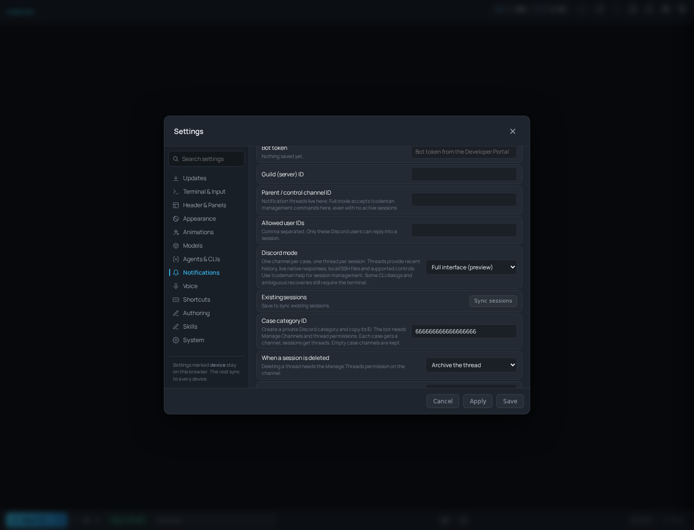
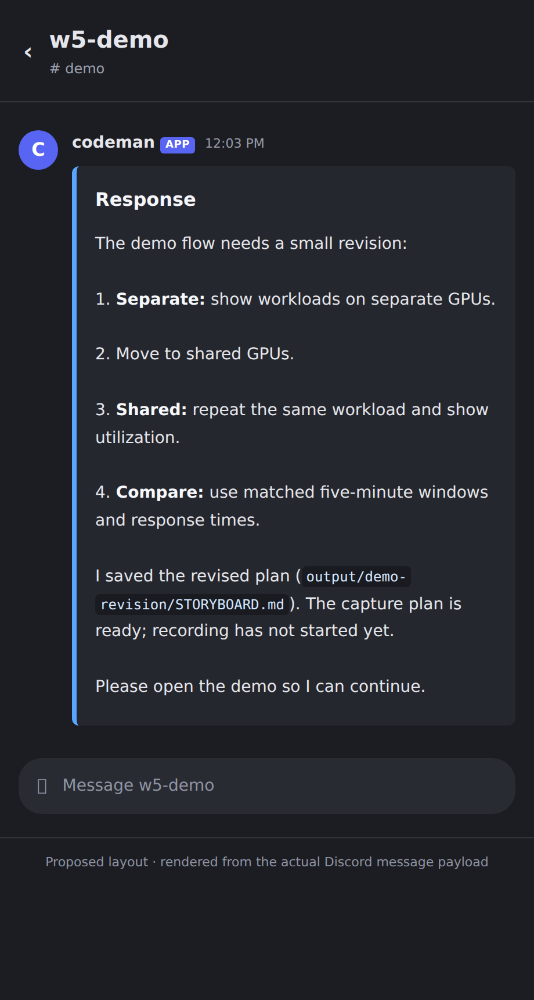
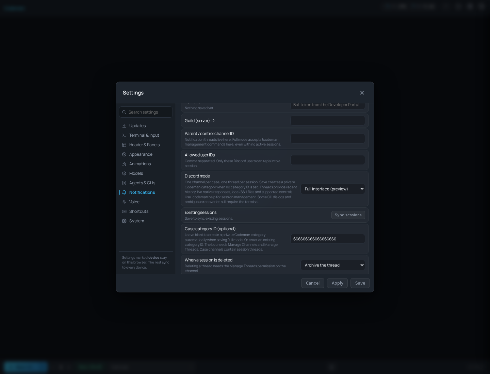
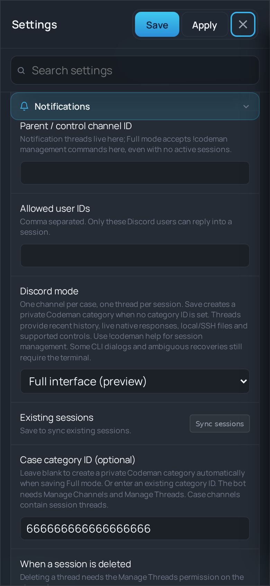
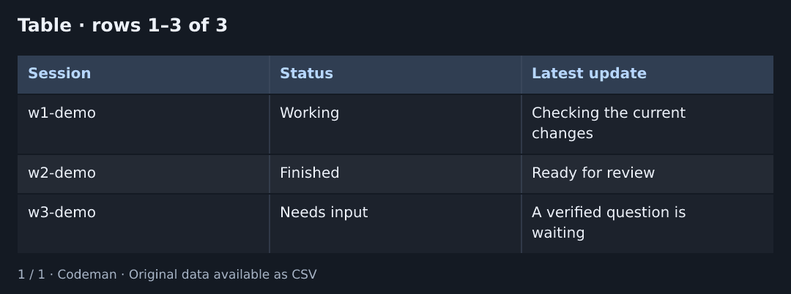

# Discord bridge

Codeman can post to a private Discord server when a session needs you, give every tab its own thread, and type your thread reply into that tab. It only makes outbound connections, so Codeman is not exposed to the internet and it works when you are away from your network.

> [!WARNING]
> A reply from an allowed Discord account is typed into agents that can run shell commands. Treat that Discord account like a login to the machine: turn on 2FA and use a strong, unique password.

## What it does

- Posts when a session asks for permission, asks a question, goes idle or errors. Which of these a CLI can raise depends on the hooks it has: Claude Code sends a turn end (`stop`, an `info` event that posts only when **Which events** is set to Everything, and `idle_prompt`, which posts by default after the turn has waited a minute). DeepSeek Harness sends only `stop`. Codex, OMP, OpenCode, Gemini, Antigravity, Pi, Grok and Copilot send no turn end, so they reach Discord through an error, a blocked respawn, a stopped crash loop or their own `codeman notify`; Codex's permission and question dialogs are also read off its screen.
- Posts a finished turn, and an error or blocked alert, as the CLI's whole last message, with its bold, lists and numbered questions kept (a Markdown table, which Discord cannot draw, becomes an aligned code block), split over several posts if it is long. It reads the CLI's transcript where it keeps one (Claude Code, Codex, DeepSeek Harness, OMP) and otherwise splits the screen into turns (OpenCode, Gemini, Antigravity, Pi, Grok, Copilot), which can start mid-message when a long answer has scrolled off. A shell, and a permission or question dialog, show the last lines of the screen instead, without the prompt row and status lines under them.
- Creates one thread per tab in a single parent channel, so a reply always reaches exactly one session.
- Types your reply into that session as a single line followed by Enter. A single digit sent while a permission or question is waiting goes as the key alone, without Enter, because the dialog acts on the keypress.
- Lets a CLI post a deliberate message (for example "press the reset button on the case") with the `codeman notify` command, which calls `POST /api/sessions/:id/discord-notify`. Each tab may post 6 a minute; past that the command says "too many messages", so a looping agent cannot ping your phone without end.
- Saves files you attach in a thread into that tab's working folder and tells the CLI the path. A CLI can send a file back with `codeman notify "message" --file <path>`.
- Tells each CLI about `codeman notify` (see [Telling the CLIs](#telling-the-clis)).

## Setup

Do these once, in order. Never paste the bot token into a chat or a session.

### 1. Create a private server

1. In Discord choose **Add a Server**, **Create My Own**, **For me and my friends**.
2. Invite nobody and create no invite links.
3. Create one text channel, for example `#codeman-cli`.

### 2. Copy the IDs

1. Open **User Settings**, **Advanced** and turn on **Developer Mode**.
2. Right-click the server, the channel and your own avatar, and choose **Copy ID** for each. You need the guild ID, the parent channel ID and your user ID.

### 3. Create the application

1. Go to <https://discord.com/developers/applications> and choose **New Application**.
2. Name it `Codeman`.

### 4. Configure the bot

On the **Bot** tab:

1. Choose **Reset Token** and copy it. It is shown once.
2. Turn **Public Bot** off, so nobody else can add it. Discord refuses this while the app has a default install link, so first open the **Installation** tab, set **Install Link** to **None** (untick Guild Install and User Install if it will not save) and save, then come back here.
3. Leave **Requires OAuth2 Code Grant** off.
4. Under **Privileged Gateway Intents** turn **Message Content Intent** on. Leave **Server Members Intent** and **Presence Intent** off.

### 5. Invite the bot with minimal permissions

On **OAuth2**, **URL Generator**:

1. Tick the scope `bot` only. Do not tick `applications.commands` or anything else.
2. Tick only these permissions (Attach Files and Embed Links are optional: without them, files cannot be sent from a CLI and links show no preview):

   | Permission               | Why                                  |
   | ------------------------ | ------------------------------------ |
   | View Channels            | See the parent channel               |
   | Send Messages            | Post in the parent channel           |
   | Send Messages in Threads | Post in each tab's thread            |
   | Create Public Threads    | Make a thread per tab                |
   | Read Message History     | Read your replies                    |
   | Add Reactions            | Acknowledge a reply that was typed   |
   | Attach Files             | Send a file from a CLI to the thread |
   | Embed Links              | Show previews for links in posts     |

3. Open the generated URL, choose your private server and authorise.
4. Check the **Installation** tab still shows **Install Link: None**, so there is no public way to add the bot.

The ticked boxes are the source of truth. As a cross-check, these eight permissions add up to the permissions integer `309237763136`.

### 6. Optional: allow deleting threads

Only needed for `onSessionDelete: delete`. Give the bot role **Manage Threads** on the parent channel only, as a channel permission override and not server-wide. Skip this if you are happy to keep or archive threads.

### 7. Never grant

Administrator, Manage Channels, Manage Roles, Manage Messages, Mention Everyone, or any voice permission.

### 8. Configure Codeman

1. Open **Settings**, **Notifications**, then the **Discord** group.
2. Enter the bot token, guild ID, parent channel ID and your user ID in the allowlist.
3. Choose the options below and press **Send test**. A test message should appear in the channel.

The token is stored in `~/.codeman/discord.json` with mode 0600. It is never returned by the API, written to logs or sent over SSE.

### 9. Phone alerts

In the Discord mobile app set the server to **All Messages**. Discord's own push notification is what reaches you off-network.

## Options

| Option            | Values                      | Default     | Effect                                                                                                                                                                                                                                                                                                                                                                                                                                            |
| ----------------- | --------------------------- | ----------- | ------------------------------------------------------------------------------------------------------------------------------------------------------------------------------------------------------------------------------------------------------------------------------------------------------------------------------------------------------------------------------------------------------------------------------------------------- |
| `threadCreation`  | `lazy`, `onSessionStart`    | `lazy`      | `lazy` makes a thread on the first notification. `onSessionStart` makes one per new tab                                                                                                                                                                                                                                                                                                                                                           |
| `onSessionDelete` | `keep`, `archive`, `delete` | `archive`   | What happens to the thread when its tab is deleted. `delete` needs Manage Threads                                                                                                                                                                                                                                                                                                                                                                 |
| `staleThreads`    | `keep`, `archive`, `delete` | `keep`      | What happens to threads this bot made that no tab uses any more, checked after startup and then daily. A deleted tab's thread leaves the map, so this also archives or deletes threads that `onSessionDelete` kept or archived. Skips threads under an hour old, other people's threads and other channels, does nothing while the thread map is empty, and closes at most 25 per run. `delete` needs Manage Threads. Use one channel per Codeman |
| `pingMode`        | `off`, `critical`, `all`    | `critical`  | `critical` pings you for permission prompts, questions, errors and urgent posts                                                                                                                                                                                                                                                                                                                                                                   |
| `scope`           | `attention`, `all`          | `attention` | `attention` skips the quiet "response complete" event. `all` sends it too                                                                                                                                                                                                                                                                                                                                                                         |
| `startupHint`     | on, off                     | on          | Tell Claude about `codeman notify` in its system prompt at launch                                                                                                                                                                                                                                                                                                                                                                                 |

## Telling the CLIs

A CLI only posts deliberately if it knows it can. While the bridge is on:

- **Claude** (`startupHint`, on by default) is launched with `--append-system-prompt`, so nothing shows in the conversation. This reaches local tabs only: remote (ssh) and Docker launches are built outside the CLI registry, and have no `codeman` command anyway.
- **Every other CLI** is sent nothing: there is no silent way to tell it, and typing the note as a message would cost a model turn per tab. It can still run `codeman notify` if you tell it to.

The text explains `codeman notify "message" --urgent`. `codeman` is on the PATH of every session from the installer or an npm install (a git checkout run without the installer has no `codeman` command) and reads `CODEMAN_SESSION_ID` and `CODEMAN_API_URL`, so no other setup is needed. Without a bridge it prints that the bridge is off and exits cleanly. Tabs started before the bridge was enabled are not told; use the skill or `CLAUDE.md` for those.

## Files

- **Received:** files you attach to a reply from an allowed user are saved as `<working folder>/.codeman-discord/<message id>-<name>` (mode 0600) and the one-line reply the CLI sees ends with `[attached: <paths>]`. At most 5 files of 8 MB each; names are reduced to letters, digits, `.`, `_` and `-`; only Discord's own HTTPS addresses are fetched. Anything skipped is named in the thread. The folder ignores itself (it holds a `.gitignore` of `*`), so nothing in it is committed. Remote (ssh) tabs have no local folder, so no file is saved for them.
- **Sent:** `codeman notify "message" --file <path>` uploads a regular file of at most 8 MB. The real path (symlinks followed) must be inside the tab's working folder, and a file on the attachment blocklist (`.env`, keys under `.ssh`, Codeman's own state) is refused even there, which stops an upload of something sensitive by mistake. The agent runs as your user, so this is a guard against accidents, not a sandbox. Remote tabs cannot send files.
- A downloaded file is untrusted content: only allowed users can send one, but a CLI that opens it is exposed to anything written inside it.

## Security model

- Only messages from IDs in `allowedUserIds`, in the configured guild, inside a thread Codeman created, are acted on. Everything else is dropped.
- A reply is reduced to one line, stripped of control characters and capped in length before it is typed.
- Replies are rate limited per session.
- A Discord outage or a bad token never affects sessions. The bridge backs off, and the last error shows in Settings.

## Rotating and revoking

- **Rotate:** in the Developer Portal choose **Bot**, **Reset Token**, paste the new token into Codeman and press **Send test**.
- **Revoke:** kick the bot from the server or delete the application, then choose **Remove token** in Settings. Deleting `~/.codeman/discord.json` alone does not reach a running bridge, which keeps the token it loaded until Codeman restarts.
- If the token is ever pasted somewhere it should not be, reset it straight away.

## Troubleshooting

| Symptom                             | Check                                                                    |
| ----------------------------------- | ------------------------------------------------------------------------ |
| Test fails with 401                 | The token is wrong or was reset. Paste the current one                   |
| Test fails with 403 or 50001        | The bot cannot see the parent channel. Check the role and the channel ID |
| Posts arrive but replies do nothing | Message Content Intent is off, or your user ID is not in the allowlist   |
| Thread is not deleted               | The bot lacks Manage Threads on the parent channel                       |
| Nothing arrives on the phone        | Check the Discord app's notification setting for the server              |

## Reply replay protection

The bridge remembers up to 2,048 recent Discord reply IDs for seven days in the private
`discord-reply-dedupe.json` metadata file. It claims an allowed reply before downloading
attachments or typing into its session, so a gateway replay normally cannot type it twice,
including after a restart. The file contains IDs and timestamps only, with mode 0600.

This is best-effort replay protection, not an exactly-once guarantee. A full disk, unreadable
file, or invalid metadata logs one content-free warning and falls back to in-memory checks.
Readable but invalid ID metadata is replaced on the next write. Files that could not be read are left untouched. Reads and writes retry on later replies; a restart during a metadata outage can lose those
checks. At capacity the oldest entries are evicted, so capacity never blocks new replies.
Notifications retain their existing delivery and retry behavior; this store never suppresses
an outbound alert or replays terminal input.

## Opt-in Full interface

Choose **Full interface** in Settings → Notifications → Discord. Notifications remains the default.
Full mode requires a single-user host until Discord accounts can be mapped to Codeman users.
The bot additionally needs **Manage Channels**, **Manage Threads**, **Read Message History**,
and **Attach Files** for the features below. Restrict the category to the configured allowlist.
Leave the category ID blank to create a private Codeman category on save, or provide an existing
category. Test with a dedicated category before connecting live sessions.

- **Cases and sessions:** each saved case gets an owned channel, even without active sessions;
  each live session gets its own thread. Ownership uses persisted identity, never a matching name.
  Removed sessions archive their owned threads. Configured users are reconciled as thread members.
- **Conversation:** exact Claude/Codex native transcripts provide readable response cards, prompt
  mirroring and bounded catch-up. Conversation, Quiet, Tools and Off views control output detail.
  Interim updates are silent; completed turns retain the configured notification behavior.
- **Controls:** supported Claude questions and permission prompts share the web answer checks.
  Model/effort controls use verified native menus for this session only. Unverified dialogs require
  the terminal. Suggestions come from the native Claude composer; send-now and queued follow-ups
  remain explicit actions, bound to the conversation and input revision.
- **Activity:** the pinned main-channel card defaults to Recent, with Working, Finished and
  Attention views. Background watching counts as work. There is no shared completion inbox.
- **History and results:** bounded history pages, transcript downloads, task updates and read-only
  workspace results/diffs are available through native cards.
- **Files and tables:** explicit output links, generated images, galleries, PNG table pages and CSV
  exports preserve readable content. Files outside the workspace need a one-file approval;
  credential locations remain blocked. Incoming CDN uploads are limited to five files of 8 MiB.
  SSH writes are limited to the private workspace `.codeman-discord/` directory, use bounded SSH
  IO and verify bytes before passing a path to the agent. Remote uploads require Python3.

These Discord layout references use synthetic/example content. Discord controls final spacing,
width and typography; no client CSS or paid bot is required.

### Status and recovery

Cards distinguish available sessions, lost connections, exited agents and unverified connections.
A failed probe never becomes an Idle success. Verify rechecks bounded native evidence before
accepting input. Reconnecting a living remote worker uses an attach-only command: a worker that
vanishes cannot be replaced by a new agent. Native IDs and hashed transcript cursors are verified
before catch-up, and uncertain input is never replayed.

Exited-worker Resume is offered only when the host supplies a strict, exact-conversation resumer.
Current upstream master does not supply that capability or the fork's durable recovery registry;
those controls remain unavailable. Optional notification-suppression metadata is honored when
provided by the host; the separate session-creation API feature is outside this bridge series.

For an unbound Codex pane, a guarded `/status` read can recover an exact native conversation.
Fresh empty-composer proof is mandatory, including during work. Drafts, pending dialogs, changed
input/profile identity and ambiguous process ownership defer recovery. No newest-file or cwd guess
is used. Other unverified CLI history/control protocols continue to require the terminal.

### Commands

Use session threads for task/history commands. Case channels and the configured parent/control
channel also accept management commands when no sessions exist.

| Command | Behavior |
| --- | --- |
| `!codeman sessions [offset]` | List session identity, host, case, group, CLI and status |
| `!codeman open <session-id>` | Return the exact owned thread link |
| `!codeman cases`, `!codeman groups` | List configured creation targets |
| `!codeman create <case> <host-id-or-local> <CLI> <group-id-or-default>` | Review and confirm one session launch through the shared creation path |
| `!codeman reconnect <session-id>` | Recheck and attach an existing remote worker without creating one |
| `!codeman history [cursor]`, `!codeman transcript` | Read bounded exact history or download an export |
| `!codeman pending`, `!codeman status`, `!codeman interrupt` | Inspect or explicitly control the current task |
| `!codeman model [model-id]`, `!codeman effort [level]` | Use supported verified session-only native settings |
| `!codeman help` | Show available commands |

Creation confirmations expire and bind the actor, case, host, group and configuration. Changes
invalidate the action. Launch success is not proof that the native CLI is ready. A failed or
ambiguous submission is not retried as a new task.

### Full-mode delivery metadata

Full mode has separate bounded delivery receipts, conversation cursors, warning state and private
UI/queue metadata. It persists accepted native provenance, confirmed multipart delivery and exact
response references. A transport checkmark does not claim that an agent started or finished work.
Explicit file failures prevent submission. Unknown input is never automatically replayed.

Full-mode posts use stable nonces for bounded retries; rate-limit delays are honored and longer
waits are surfaced. Formatting fingerprints prevent reusing a partially delivered plan with
changed content. These Full-mode journal/retry rules do not apply to default Notifications, whose
best-effort replay protection and storage-failure fallback are described above.

### Diagnostics

Opt-in bridge diagnostics provide bounded timing and sanitized CPU/allocation summaries without
opening an inspector listener or exporting raw profiles, prompts, credentials or heap snapshots.
They remain disabled by default. The bridge has no authority to start or recover a native task
just to collect diagnostics.

### Private Full-mode state

| File | Contents |
| --- | --- |
| `discord-case-categories.json`, `discord-session-channels.json`, `discord-case-threads.json` | Owned category/channel/thread identities and lifecycle intent |
| `discord-conversation-progress.json` | Exact native boundaries and prompt provenance |
| `discord-delivery.json` | Bounded delivery receipts and native execution evidence |
| `discord-ui.json` | Card references, queued follow-up text and activity/settings references |
| `discord-history-warnings.json` | References for unresolved owned history warnings |

These private files live under the configured instance data directory. Queue contents are private;
startup does not replay uncertain submissions. Notifications uses the separate reply-ID store above.

### Settings and table rendering previews

