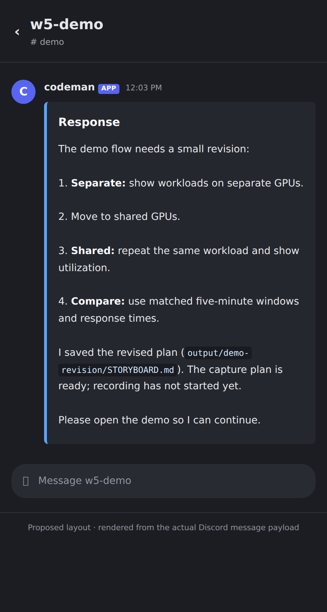

# Discord bridge

Codeman can post to a private Discord server when a session needs you, group sessions into case channels and session threads, and paste your reply into that session. It only makes outbound connections, so Codeman is not exposed to the internet and it works when you are away from your network.

> [!WARNING]
> A reply from an allowed Discord account is typed into agents that can run shell commands. Treat that Discord account like a login to the machine: turn on 2FA and use a strong, unique password.

## What it does

- Session thread titles show **⚫ Idle**, **🟡 Working**, **🔴 Needs input**, or **⚫ Offline**. Foreground execution, background tasks and waiting/checking agents all count as Working, so transitions between work types do not rename the thread. Typing continues while any work is observed. Input-needed and exit take precedence; Idle settles after 30 seconds. Discord creates system notices for renames and does not offer silent thread renames. Cosmetic updates never create or reopen threads, send messages or interrupt execution.
- Claude Code's native next-prompt suggestion appears on the session card when its styled terminal composer is empty and the session is ready. **Use suggestion** opens an editable prompt; only submitting that form sends it. Typed drafts, busy/background sessions and stale suggestions are excluded. This uses Claude's own suggestion, without an extra model call.
- Posts when a session asks for permission, asks a question, goes idle or errors. Which of these a CLI can raise depends on the hooks it has: Claude Code sends a turn end (`stop`, an `info` event that posts only when **Which events** is set to Everything, and `idle_prompt`, which posts by default after the turn has waited a minute). DeepSeek Harness sends only `stop`. Codex, OMP, OpenCode, Gemini, Antigravity, Pi, Grok and Copilot send no turn end, so they reach Discord through an error, a blocked respawn, a stopped crash loop or their own `codeman notify`; Codex's permission and question dialogs are also read off its screen.
- Posts a finished turn, and an error or blocked alert, as the CLI's whole last message, with its bold, lists and numbered questions kept (a Markdown table becomes stacked labeled records that wrap naturally on mobile), split over several posts if it is long. It reads the CLI's transcript where it keeps one (Claude Code, Codex, DeepSeek Harness, OMP) and otherwise splits the screen into turns (OpenCode, Gemini, Antigravity, Pi, Grok, Copilot), which can start mid-message when a long answer has scrolled off. A shell, and a permission or question dialog, show the last lines of the screen instead, without the prompt row and status lines under them.
- Notifications mode creates one thread per tab in a parent channel. Full interface mode creates one channel per case in your configured category, with one thread per session. For example, `#saif` contains `w1-saif` and `w2-saif`. Replies reach that exact session.
- Pastes your reply into that session as one prompt, preserving Markdown, indentation and line breaks, then sends Enter separately. A single digit sent while a permission or question is waiting goes as the key alone, without Enter, because the dialog acts on the keypress.
- Lets a CLI post a deliberate message (for example "press the reset button on the case") with the `codeman notify` command, which calls `POST /api/sessions/:id/discord-notify`. Each tab may post 6 a minute; past that the command says "too many messages", so a looping agent cannot ping your phone without end.
- Saves files you attach in a thread into that tab's working folder and tells the CLI the path. A CLI can send a file back with `codeman notify "message" --file <path>`.
- Tells each CLI about `codeman notify` (see [Telling the CLIs](#telling-the-clis)).

## Setup

Do these once, in order. Never paste the bot token into a chat or a session.

### 1. Create a private server

1. In Discord choose **Add a Server**, **Create My Own**, **For me and my friends**.
2. Invite nobody and create no invite links.
3. Create one text channel, for example `#codeman-cli`.

### 2. Copy the IDs

1. Open **User Settings**, **Advanced** and turn on **Developer Mode**.
2. Right-click the server, the channel and your own avatar, and choose **Copy ID** for each. You need the guild ID, the parent channel ID and your user ID.

### 3. Create the application

1. Go to <https://discord.com/developers/applications> and choose **New Application**.
2. Name it `Codeman`.

### 4. Configure the bot

On the **Bot** tab:

1. Choose **Reset Token** and copy it. It is shown once.
2. Turn **Public Bot** off, so nobody else can add it. Discord refuses this while the app has a default install link, so first open the **Installation** tab, set **Install Link** to **None** (untick Guild Install and User Install if it will not save) and save, then come back here.
3. Leave **Requires OAuth2 Code Grant** off.
4. Under **Privileged Gateway Intents** turn **Message Content Intent** on. Leave **Server Members Intent** and **Presence Intent** off.

### 5. Invite the bot with minimal permissions

On **OAuth2**, **URL Generator**:

1. Tick the scope `bot` only. Do not tick `applications.commands` or anything else.
2. Tick only these permissions (Attach Files and Embed Links are optional: without them, files cannot be sent from a CLI and links show no preview):

   | Permission               | Why                                  |
   | ------------------------ | ------------------------------------ |
   | View Channels            | See the parent channel               |
   | Send Messages            | Post in the parent channel           |
   | Send Messages in Threads | Post in each tab's thread            |
   | Create Public Threads    | Make a thread per tab                |
   | Read Message History     | Read your replies                    |
   | Add Reactions            | Acknowledge a reply that was typed   |
   | Attach Files             | Send a file from a CLI to the thread |
   | Embed Links              | Show previews for links in posts     |

3. Open the generated URL, choose your private server and authorise.
4. Check the **Installation** tab still shows **Install Link: None**, so there is no public way to add the bot.

The ticked boxes are the source of truth. As a cross-check, these eight permissions add up to the permissions integer `309237763136`.

### 6. Optional: allow deleting threads

Only needed for `onSessionDelete: delete`. Give the bot role **Manage Threads** on the parent channel only, as a channel permission override and not server-wide. Skip this if you are happy to keep or archive threads.

### 7. Never grant

Administrator, server-wide Manage Roles, Manage Messages, Mention Everyone, or voice permissions. Full interface mode additionally needs Manage Channels, Create Public Threads, Send Messages in Threads and Manage Threads on the private case category.

### 8. Configure Codeman

1. Open **Settings**, **Notifications**, then the **Discord** group.
2. Enter the bot token, guild ID, parent channel ID and your user ID in the allowlist.
3. Choose the options below and press **Send test**. A test message should appear in the channel.

The token is stored in `~/.codeman/discord.json` with mode 0600. It is never returned by the API, written to logs or sent over SSE.

### 9. Phone alerts

In the Discord mobile app set the server to **All Messages**. Discord's own push notification is what reaches you off-network.

## Options

### Notifications or Full interface

Settings → Notifications → Discord has a **Discord mode** selector, independent of the enable switch:

The modal’s main **Save** and **Apply** buttons save edited Discord settings too. The group’s own **Save** remains available. Full mode automatically creates a private **Codeman** category when **Case category ID** is blank; you can enter an existing category ID instead. A rejected save keeps Settings open and brings the error into view. The bot needs **Manage Channels** and **Manage Threads**, as well as the message/thread permissions listed below.

- **Notifications** (`mode: "notifications"`, the default) preserves the existing alerts and thread replies. Threads are created on the first alert, or for new tabs when **Create threads** is set to **For every new tab**.
- **Full interface (preview)** (`mode: "full"`) creates a case channel and one thread per session for every existing session when enabled, after restart/restoration, and for each new session immediately, inside the configured case category. This overrides lazy thread creation without changing the saved Notifications preference. It does not submit a prompt or start an agent.

Full interface mode includes channel synchronization, bounded native history/backfill, live responses, local/SSH files and the supported controls below. Provider-specific limitations remain; it does not mirror a terminal screen.

Use **Sync sessions** to check discovery, retry failed cleanup and provision missing session destinations. The Settings API returns `sessionSync` with `state`, `total`, `ready` and `failed`; `POST /api/discord/sync` joins or starts a discovery pass (admin only in multi-user mode). Saves schedule discovery in the background so a slow Discord connection does not block Settings. Successful mappings are reused after retry and restart.

Changing back to Notifications preserves existing threads and their history. Disable the bridge with its enable switch. Only explicit session deletion uses the existing deletion policy; a dead agent or disconnected SSH host is not deletion. Full mode seeds each destination with at most six recent user-visible turns, clearly labeled Historical context. It persists exact native cursor boundaries before posting and confirmed per-turn progress afterward, so retry/restart does not duplicate catch-up. Use history/transcript commands for older or complete bounded context. Unavailable history leaves the session thread usable and can be retried by synchronization. No historical posts ping users.

| Option            | Values                      | Default         | Effect                                                                                                                                                                                                                                                                                                                                                                                                                                            |
| ----------------- | --------------------------- | --------------- | ------------------------------------------------------------------------------------------------------------------------------------------------------------------------------------------------------------------------------------------------------------------------------------------------------------------------------------------------------------------------------------------------------------------------------------------------- |
| `mode`            | `notifications`, `full`     | `notifications` | Legacy notification behavior or proactive session discovery in the full-interface preview.                                                                                                                                                                                                                                                                                                                                                        |
| `threadCreation`  | `lazy`, `onSessionStart`    | `lazy`          | `lazy` makes a thread on the first notification. `onSessionStart` makes one per new tab                                                                                                                                                                                                                                                                                                                                                           |
| `onSessionDelete` | `keep`, `archive`, `delete` | `archive`       | What happens to the thread when its tab is deleted. `delete` needs Manage Threads                                                                                                                                                                                                                                                                                                                                                                 |
| `staleThreads`    | `keep`, `archive`, `delete` | `keep`          | What happens to threads this bot made that no tab uses any more, checked after startup and then daily. A deleted tab's thread leaves the map, so this also archives or deletes threads that `onSessionDelete` kept or archived. Skips threads under an hour old, other people's threads and other channels, does nothing while the thread map is empty, and closes at most 25 per run. `delete` needs Manage Threads. Use one channel per Codeman |
| `pingMode`        | `off`, `critical`, `all`    | `critical`      | `critical` pings you for permission prompts, questions, errors and urgent posts                                                                                                                                                                                                                                                                                                                                                                   |
| `scope`           | `attention`, `all`          | `attention`     | `attention` skips the quiet "response complete" event. `all` sends it too                                                                                                                                                                                                                                                                                                                                                                         |
| `startupHint`     | on, off                     | on              | Tell Claude about `codeman notify` in its system prompt at launch                                                                                                                                                                                                                                                                                                                                                                                 |

### Case channels and session threads (Full mode)

Leave **Case category ID** blank and save enabled Full mode to create a private **Codeman** category automatically. It denies View Channel to @everyone and grants access to the bot and your configured allowed users; Discord administrators retain their usual access. Or create a **private category** yourself and copy its ID into this optional field. Grant the bot **Manage Channels**, **Create Public Threads**, **Send Messages in Threads** and **Manage Threads**, plus the message permissions above, scoped to that category. New case channels copy its permission overwrites. A public thread inside a private case channel inherits that channel's visibility; it is not public to the server.

```text
Codeman (private category)
  #saif
    w1-saif   → its existing Codex session
    w2-saif   → its existing Claude session
  #home
    w1-home   → its existing SSH session
```

Grouping uses configured case roots, initial workspaces, transport/host and owner metadata. Tab names such as `w1-saif` do not determine membership. Same-name cases on different hosts or roots stay separate. An unlinked shell groups only with sessions in its exact workspace on the same host and owner. This does not restart agents, change cwd, reset shell variables or copy environments. Each thread still targets one exact native session.

Send prompts, replies, files and task/history commands **inside the session thread**. A plain message in the case channel returns session-thread links and submits nothing, including when only one session exists. Management commands work there and in the configured Parent / control channel; `!codeman open <session-id>` finds an exact session. There is no implicit default session.

**When a session is deleted** keeps, archives (default), or deletes only that session's thread. The shared case channel and siblings remain. Empty case channels are retained for review; cleanup never deletes a case channel automatically. A crash, disconnected host or recoverable missing session is not deletion. Unlocked auto-archived active threads reopen on use; a manually locked thread requires an explicit Discord unlock. Cleanup failures remain pending for retry.

Case channels and thread IDs are saved privately in instance-scoped `discord-case-channels.json` and `discord-case-threads.json`. Parent channels require the exact recorded guild, category and per-intent topic marker. Session threads require the exact starter-message ID, parent and bot owner. Creation is durably recorded before HTTP; a thread created from a message has that message's ID, allowing reconciliation after a lost response without adopting a similarly named thread. Uncertain starter posts use a stable nonce; aged uncertainty is reconciled from up to 100 recent messages, otherwise provisioning pauses for manual review. Do not delete ownership files to retry.

**Migrating from the earlier per-session-channel preview:** save Full mode and use **Sync sessions**. New case channels/threads are created and bounded historical context is loaded there. Old `discord-channels.json` resources and legacy notification threads/history are preserved, but old destinations do not accept input in Full mode. No Discord messages are moved or deleted. Automatic category ownership is stored privately in `discord-case-categories.json`. Interrupted creation is reconciled from a unique temporary setup name and exact permission overwrites; similarly named unowned categories are never adopted. A permissions refusal leaves the previous configuration intact and can be retried after the bot role is updated.

The old `onChannelDelete` setting is retained for configuration compatibility and does not delete shared case channels. Switching back to Notifications resumes its original maps/preferences. The Notifications stale-thread sweep never runs in Full mode.

## Change an existing session's model or effort

In Full mode, send these commands inside that session's thread:

| Command                     | Result                                                                                                |
| --------------------------- | ----------------------------------------------------------------------------------------------------- |
| `!codeman model`            | Inspect the native model and available choices, with selection buttons where canonical IDs are known. |
| `!codeman model gpt-6-luna` | Select a Codex model by ID for this session.                                                          |
| `!codeman model sonnet`     | Select an alias offered by the current Claude picker for this session.                                |
| `!codeman effort`           | Inspect the current effort and the model's available levels.                                          |
| `!codeman effort high`      | Apply and verify the effort for this session.                                                         |

These controls work with an idle Claude or Codex session, including SSH sessions, while keeping the existing conversation and thread. An unfinished composer draft, a pending dialog, a stopped agent or a session which is working is refused. Incoming Codeman keyboard input is held during a native settings transaction and replayed in order afterward; if new input arrives before a setting is applied, the operation cancels and dismisses its own picker. Buttons expire and bind to the session/input revision. Unsupported CLIs, Docker sessions, unknown menu layouts and unverifiable results require the web terminal. In multi-user mode these controls remain disabled until Discord identities can be mapped to Codeman users.

The bridge verifies the CLI's resulting setting before reporting success. It neither restarts the agent nor edits configuration files. Codex uses its session-only inline `/model` commands and rereads `/status`, including the conversation ID. Claude uses its verified native model picker and the **s — use this session only** action for both model and effort, then rereads that picker. It never sends Claude's inline `/model <alias>` or `/effort <level>` commands: those save defaults for future sessions in current Claude builds. Older builds without the explicit session-only picker action are refused. If a change cannot be confirmed, inspect the terminal before retrying; it is not automatically replayed.

Model availability and effort levels come from the running CLI's picker and public catalog metadata. If a Codex catalog cannot supply canonical IDs or supported efforts, the bridge still shows the native model labels and refuses to invent IDs or reasoning choices. CLI-reported selection does not override provider access or organization restrictions.

## Telling the CLIs

A CLI only posts deliberately if it knows it can. While the bridge is on:

- **Claude** (`startupHint`, on by default) is launched with `--append-system-prompt`, so nothing shows in the conversation. This reaches local tabs only: remote (ssh) and Docker launches are built outside the CLI registry, and have no `codeman` command anyway.
- **Every other CLI** is sent nothing: there is no silent way to tell it, and typing the note as a message would cost a model turn per tab. It can still run `codeman notify` if you tell it to.

The text explains `codeman notify "message" --urgent`. `codeman` is on the PATH of every session from the installer or an npm install (a git checkout run without the installer has no `codeman` command) and reads `CODEMAN_SESSION_ID` and `CODEMAN_API_URL`, so no other setup is needed. Without a bridge it prints that the bridge is off and exits cleanly. Tabs started before the bridge was enabled are not told; use the skill or `CLAUDE.md` for those.

## Files

- **Received:** files you attach to a reply from an allowed user are saved as `<working folder>/.codeman-discord/<message id>-<name>` (mode 0600) and the formatted reply the CLI sees ends with `[attached: <paths>]`. At most 5 files of 8 MB each; names are reduced to letters, digits, `.`, `_` and `-`; only Discord's own HTTPS addresses are fetched. Anything skipped is named in the thread. The folder ignores itself (it holds a `.gitignore` of `*`), so nothing in it is committed. SSH sessions receive verified uploads in the remote workspace, using the existing host key, user, port and SSH options. Python 3 is required on the remote host. Uploads use a private directory and file permissions; failures prevent prompt submission.
- **Sent:** `codeman notify "message" --file <path>` uploads a regular file of at most 8 MB. The real path (symlinks followed) must be inside the tab's working folder, and a file on the attachment blocklist (`.env`, keys under `.ssh`, Codeman's own state) is refused even there, which stops an upload of something sensitive by mistake. The agent runs as your user, so this is a guard against accidents, not a sandbox. For local or SSH sessions, send `!codeman file /absolute/path` in the mapped destination. The bridge reads only a bounded regular file inside that exact workspace; symlink traversal and sensitive paths are refused. Transfers show progress reactions and never execute a model turn.
- A downloaded file is untrusted content: only allowed users can send one, but a CLI that opens it is exposed to anything written inside it.

## Security model

### Delivery and retries

Formatted replies preserve logical line breaks, tabs and leading/trailing blank lines in one bracketed paste, followed by one Enter. An internal whitespace-preservation option uses tmux's raw-newline paste mode instead of changing ordinary keyboard input. A direct PTY without the bracketed-paste transport refuses structured multiline input instead of submitting separate lines. Terminal control sequences are removed; Markdown remains literal text for the agent.

Response chunks retain code-block language hints, close/reopen code fences and avoid splitting Unicode surrogate pairs. An outbound payload fingerprint prevents automatic multipart retries from skipping changed content after a formatter upgrade. If an existing pending response has different or legacy formatting metadata, review it before resending; the bridge refuses to guess.

Inbound message IDs are durably claimed before any terminal write, including file-only replies. Duplicate gateway events reuse that claim across restart and never type the same message again. An interrupted transfer or attachment refusal prevents the prompt from being typed. A reply rejected by the one-second rate limit is explicitly reported; send a new message to retry it.

The ✅ reaction means **terminal transport accepted the input**, not that the agent started or completed the task. A false/throwing terminal write, or a restart during submission, is **uncertain**. Check the native session before sending anything again. The bridge never retries the entire prompt after an ambiguous write and never silently replays pending input on startup. Correlation with native running/completed turns will be added with live conversation observation.

Outbound posts use a stable Discord nonce for bounded retries (at most three requests) after a network error or server failure. Rate-limit delays are honored; waits over 30 seconds are surfaced instead of retried early. Notification-thread creation is not retried after an ambiguous network/server failure. Full-mode session threads use the durable starter-message reconciliation described above. Multi-part responses are serialized per session, record completed parts, and report failure if any part fails. A later retry can skip delivered parts; an uncertain post is not blindly replayed after restart.

Delivery metadata lives in instance-scoped `discord-delivery.json`, mode 0600, written atomically with file sync. It contains IDs, timestamps and delivery states, **not prompt text, message bodies, file bytes or bot tokens**. Retention is seven days with a 2,048-record cap; only the latest 256 completed outbound records are retained. Saturation or corrupt/unreadable tracking pauses new input rather than losing deduplication. Do not delete this file to retry a task: doing so discards the protection against replay.

Admins can inspect the latest 50 records through `GET /api/discord/deliveries`. States distinguish received input, transferred files, submission in progress, transport acceptance, delivered Discord posts, failure and uncertainty. This metadata is not a durable message-body outbox: uncertain output after a long outage requires review rather than a guaranteed automatic resend. Discord's nonce deduplication only covers recent messages.

- Only messages from IDs in `allowedUserIds`, in the configured guild, inside a thread Codeman created, are acted on. Everything else is dropped.
- Replies retain line breaks and indentation; terminal escape/control sequences are removed. Replies over 20,000 characters are refused explicitly instead of being silently truncated.
- Replies are rate limited per session.
- A Discord outage or a bad token never affects sessions. The bridge backs off, and the last error shows in Settings.

## Rotating and revoking

- **Rotate:** in the Developer Portal choose **Bot**, **Reset Token**, paste the new token into Codeman and press **Send test**.
- **Revoke:** kick the bot from the server or delete the application, then choose **Remove token** in Settings. Deleting `~/.codeman/discord.json` alone does not reach a running bridge, which keeps the token it loaded until Codeman restarts.
- If the token is ever pasted somewhere it should not be, reset it straight away.

## Troubleshooting

| Symptom                             | Check                                                                    |
| ----------------------------------- | ------------------------------------------------------------------------ |
| Test fails with 401                 | The token is wrong or was reset. Paste the current one                   |
| Test fails with 403 or 50001        | The bot cannot see the parent channel. Check the role and the channel ID |
| Posts arrive but replies do nothing | Message Content Intent is off, or your user ID is not in the allowlist   |
| Thread is not deleted               | The bot lacks Manage Threads on the parent channel                       |
| Nothing arrives on the phone        | Check the Discord app's notification setting for the server              |

## Read-only conversation commands (Full mode)

Send `!codeman status` for the exact mapped session status. `!codeman history` shows recent role-separated, timestamped turns, with a cursor command to load older turns. `!codeman transcript` downloads the bounded user-visible transcript. These commands never type a prompt or consume a model turn.

Claude and Codex readers use an exact native UUID, including SSH sessions. Python 3 must be installed on the host containing the transcript. Custom CLAUDE_CONFIG_DIR/CODEX_HOME overrides are honored. Missing or ambiguous identity/transcripts, unsupported CLIs and containers report history unavailable, without guessing from a shared working directory or terminal redraws. At most the last 2 MB of complete JSONL rows are read; truncated history is explicitly labeled. Only user/assistant text is exported: reasoning, tool calls/results, synthetic/system context and sidechains are excluded. Cursors are bound to conversation and row identity; after conversation replacement, request history again.

## Live native responses (Full mode)

Full mode follows new Claude/Codex assistant text after the durable historical boundary. It never interprets terminal redraws as fresh answers. Tables become labeled records rather than padded monospace grids, so long status text wraps naturally. Inline formatting/links and all fields are retained; literal code-fenced tables remain unchanged. Oversized or excessively expanding tables are left as written to keep processing bounded. Updates are bounded and split for Discord; oversized responses include a text attachment. Native assistant responses use Components V2: a compact colored header with Markdown in a separate top-level Text Display, preserving chat width and code blocks. Body chunks remain below 1,900 characters and link previews are suppressed. Green “Turn finished” requires native completion for the exact preceding user turn; an answer without that proof has a neutral blue “Response received” header. This confirms turn completion, not the truth of build/test/deployment claims in its prose. Session control cards remain separate. Explicit Codex commentary and Claude tool-use text update one compact progress message instead of posting repeated Response headings; unclassified text is retained as an ordinary answer. “Show updates” opens the latest six updates in a private panel from exact native history. Response buttons reuse guarded results/files, download the exact response and link to the web session. Menus can expire; reopen session controls or History if needed. Native assistant messages use their Markdown directly, without role/ISO timestamp headings or repeated host/session labels. Reserved internal memory-citation annotations are omitted from assistant display text before splitting, clipping or exporting; literal fenced code examples and ordinary citations remain intact. Metadata-only turns advance the native cursor without producing empty chat posts. A single durable status message is edited in place (Working, Needs your answer, Done, Interrupted or Task failed); Done requires native completion evidence. Automatic idle/stop alerts do not repeat text already delivered by the exact native stream. Real questions, approvals, errors, deliberate notifications and attachments are preserved. When native history is unavailable or streaming is off, ordinary notification fallback remains available. Historical catch-up keeps role/provenance labels but omits redundant ISO timestamps; explicit history/transcript commands retain their timestamps. `!codeman stream responses` is the default, `!codeman stream verbose` additionally includes bounded **tool result text** (not tool arguments or reasoning), and `!codeman stream off` pauses output for this destination. History/transcript commands remain available.

Polling is bounded and round-robin (up to eight sessions per pass), with longer intervals for idle/SSH sessions. It is response-event streaming, not keystroke/token-level terminal mirroring. Unsupported/missing native histories pause output with actionable feedback; the bridge does not replay scrollback. Mode changes, tab switches and process restart preserve native boundaries.

Delivery records can move from input accepted to running/completed/interrupted/execution error only after matching the exact conversation, a new native user-message cursor and the submitted prompt fingerprint. Codex completion needs a native turn ID; Claude completion needs linked message ancestry and an end-turn marker. Unverifiable execution stays unconfirmed. A queued prompt cannot steal a previous task's completion. No task is resubmitted to recover a response. After an ambiguous long outage, use history/transcript to retrieve the answer explicitly rather than blindly resending the task.

## Questions, permissions and interruption (Full mode)

Question/permission alerts offer buttons when the existing web-UI answer adapter can verify the native dialog. Use `!codeman pending` to refresh the choices, or use the exact `!codeman answer ...` fallback shown below the prompt. Choices retain their original CLI labels; the bridge never turns an allow-once action into an allow-always action. A question/permission dialog blocks ordinary prompt replies in Full mode, preventing a stale digit from becoming unrelated terminal input.

Controls bind the exact session, channel, message, prompt ID, revision and allowed Discord user. Duplicate clicks, changed questions, expired controls and web/terminal resolutions are rejected; resolved controls are removed on the next refresh. Buttons expire after ten minutes and after a server restart; request pending again. Gateway components require no slash-command registration, public interaction URL or new bot intents. Use a bot with Interactions Endpoint URL unset so Discord delivers interactions over the Gateway ([Discord interaction delivery](https://github.com/discord/discord-api-docs/blob/main/developers/interactions/overview.mdx)). Message Content intent remains required.

`!codeman interrupt` offers a confirmation for the current task. It sends Ctrl+C through the existing session input path and leaves the session open. A changed/finished task invalidates the confirmation; interruption is requested, not assumed complete. No destructive session deletion control is exposed.

Claude's verified dialogs work through the shared approval service for local/SSH sessions. Codex and other screen-only dialogs flagged by Codeman as terminal-only remain terminal-only: it cannot safely infer their approval keystrokes. Free-text/multipart prompts that the native adapter cannot verify must be completed in the terminal. Discord shows that limitation rather than pretending approval succeeded.

## Session management (Full mode)

Use these commands in a session thread, its case channel, or in the configured **Parent / control channel** when no sessions exist:

- `!codeman sessions [offset]` lists session ID, host, case, group, CLI and status. `!codeman open <session-id>` returns its exact session-thread link.
- `!codeman cases` lists configured cases and their host IDs; `!codeman groups` lists group IDs; `!codeman help` lists commands.
- `!codeman create <case> <host-id|local> <CLI> <group-id|default>` shows a review and a Confirm button. Choose the exact configured case/host and CLI. `default` inherits the existing case group policy. Confirmations expire after one minute and are single-use. Configuration changes invalidate them. The shared creation path starts the selected CLI with no submitted task.
- `!codeman recoveries` lists saved Recovery Queue records. `!codeman recover <record-id> <reconnect|resume>` reviews the explicit action. Reconnect attaches an existing remote agent; resume requires an exact native conversation and the shared resumable state. It does not select by cwd, create a blank recovery conversation or replay the interrupted task. Ambiguous/manual cases require the web UI.
- `!codeman reconnect <session-id>` checks an existing remote transport and attaches only when its local SSH pane is confirmed dead. It shares the automatic reconnect fence and does not restart a healthy agent. A dead remote agent requires a saved recovery record.

Creation and recovery use the same case/group/CLI validation and recovery service as the web UI, including a shared API/connector concurrency fence and cancellation after dismissal. Recovery preserves saved name/group through the shared service; the resulting session thread is linked in the result. A launch returning is not proof of native readiness: check status and the native response stream. A failure or lost acknowledgement is never retried by resubmitting a task.

Lifecycle management is available in single-user mode. It remains disabled in multi-user mode until Discord IDs have explicit Codeman-user mappings, avoiding an implicit administrator identity for lifecycle operations. The existing administrator-configured Discord allowlist still governs all bridge messages. A control-channel message without the `!codeman` prefix is ignored. Notifications mode keeps its original threads and reply behavior.

Full mode covers native conversation output, bounded history, files and supported controls; it is not a pixel/terminal mirror. Unverified provider approval dialogs, Docker history and ambiguous native recovery still require the web UI. Test in a dedicated category before enabling it for live sessions.

For a restored SSH Codex tab without a saved conversation ID, history can recover an exact `codex resume <UUID>` invocation from the attached tmux pane’s sole interactive Codex process. It verifies that exact transcript before recording the ID. Multiple agents, missing resume arguments, missing transcripts and other ambiguity remain unavailable; workspace names and the newest transcript are never used as identity evidence.

### Readable response cards in Full mode

New assistant responses use Discord's native colored embeds: a blue response card,
bold short step labels, space between numbered steps and inline styling for simple
file paths. Links remain clickable inside the card without generating an unrelated
URL-preview card. Code blocks, existing Markdown links, inline code and quoted
examples retain their contents. Discord controls the client's fonts and layout;
this does not inject terminal colors or use ANSI code boxes for prose.

Routine completed answers show **Response**, without repeating the session name,
hostname or “Waiting for Input” wrapper. A second idle/stop event for the same
fallback answer does not add another bare alert header. Critical alerts retain
their title/context and use a red accent; warning alerts use amber. Existing
allowlist/ping rules still apply, and only the first part can ping.

Long answers are split into numbered cards within Discord's embed limits. Very
long responses keep their explicit continuation notice and the native stream's
full-response attachment behavior. Notifications mode retains its existing plain
message format. This affects future posts; it does not edit previous Discord
messages.



The image is a layout preview rendered from a real generated message payload,
using a generic example. Actual client spacing follows Discord's settings.
Embed limits and fields follow the [Discord message documentation](https://discord.com/developers/docs/resources/message#embed-object).

### Native workspace controls (Full mode)

Full mode maintains an owned session control card in each active session thread and a workspace dashboard in the configured control channel. Cards are pinned when the bot has permission; missing pin permission leaves the card usable. Updates edit the existing owned message and do not ping users. `/codeman` opens a private dashboard; `!codeman ui`, `!codeman dashboard`, `!codeman settings`, `!codeman queue` and `!codeman results` are text fallbacks.

- **Session card:** shows the exact conversation, observed activity, reported model (or its source), launch approval policy, recent delivery and the latest visible user prompt when available. Interrupt reuses the existing task-bound confirmation. History, pending question, settings, queue, result/file actions and an exact web-session link are available from the card. Unknown runtime effort is shown as unknown; launch defaults are not treated as live verification.
- **Delivery receipts:** received, input delivered, native submitted, working and finished are separate states. Transport acceptance does not prove submission or completion. An unconfirmed submission must be inspected before resending; neither gateway redelivery nor restart repeats it. Emoji reactions and the session control card show processing status; routine per-prompt delivery cards are not posted. Delivery tracking and downloadable execution receipts remain available. Legacy delivery cards are removed only after verifying their saved bot ownership and exact marker in an active owned thread; archived, foreign or edited messages are left alone.
- **Settings:** model and effort menus reuse the provider's verified native controls for the same Claude/Codex conversation. Inspection requires an idle, empty native composer. Future Codex defaults are a separate explicit form. Approval flags are launch settings; saving a future default never restarts a process or silently replaces a conversation. Complete custom commands retain their authority.
- **Questions:** native choice menus are tied to the exact prompt revision and reject stale answers, including prompts answered from the terminal or web UI. Only answer types supported by the shared native approval service are offered: selectable dialog choices and free text for supported idle prompts. Screen-read or otherwise unverifiable dialogs remain terminal-only. A generic multi-select or text answer is never translated into unverified keystrokes.
- **Follow-ups:** when a session is working, a message offers **Send now**, **Queue next** and **Cancel**. Only one choice can execute. Send now uses the existing input path and can steer the active CLI task. The queue supports add, edit and remove, with ten prompts per session and fifty total. It dispatches one prompt only after exact native completion and a fresh empty-composer capture under the shared input lease. Drafts, command/completion prefixes, questions, disconnections, intervening manual input, changed conversations and changed Discord configuration pause dispatch. After manual input changes the queued boundary, remove and add the follow-up explicitly rather than silently retargeting it. Automatic dispatch currently supports Claude and Codex native terminals, including SSH; unsupported CLIs retain manual input. A submitting prompt found on restart becomes unconfirmed and is never automatically replayed. Other queued items remain visible; if the restored input revision cannot be proven, dispatch pauses for explicit review/removal and re-addition. Queued text is stored in the private `discord-native-ui.json` (0600), expires for automatic dispatch after 24 hours, and is removed after confirmed input delivery or explicit removal. Prepared attachments remain in the workspace; they are not automatically deleted.
- **Results and artifacts:** tracked native completion updates a result card. Workspace changes and downloadable diffs are explicitly labeled a shared-workspace snapshot, not attributed to a task without evidence. Secret, symlink, deleted and out-of-scope paths are omitted through the existing file guards, with bounded export sizes. File downloads reuse the guarded local/SSH service; Discord previews supported attachment formats. Execution-receipt downloads contain observed execution/delivery metadata. Test success, merge and deployment are not inferred from assistant prose.
- **Dashboard:** browse paginated sessions, filter Working / Needs input / Idle, open their exact thread, or choose case, host and CLI for a confirmed launch. It reuses existing case identities and the launch service, including aliases and host distinctions.
- **Message actions:** the message Apps menu offers **Codeman: Send to session**, **Codeman: Queue follow-up** and **Codeman: Start session**. Select an explicit destination and review the text and attachment count before confirming. The source is re-read before transfer/submission; changed messages are refused. Creating a session from a selected message requires the existing launch confirmation, then a separate review/send of the source after the exact native conversation is ready. Selected text remains user-provided context, not trusted application instructions.

Menus are bound to the allowed actor, origin channel, current configuration and exact conversation. Temporary menus expire after six minutes; use `/codeman` or `!codeman ui` to reopen them after restart or expiry. Permanent response buttons (**Download response**, **Show updates**, **Results & files**) can recover their exact read-only action after expiry or restart while the same conversation remains in bounded native history. Recovery verifies the stored Discord message is bot-owned in the same thread and still contains that button; it never substitutes the latest answer. Changed sessions/configuration, deleted messages or expired history are refused. Questions, approvals, queue actions and other state-changing controls remain temporary. Session/card state and queue ownership survive restart. Legacy Notifications mode is unchanged. A failed UI-state read pauses the queue instead of discarding its ownership or deduplication metadata. `GET /api/discord` includes `nativeUiError` when a card/queue synchronization problem needs attention.

The bot needs the existing guild application-command scope for slash/context actions. Command registration is guild-scoped and never bulk-overwrites unrelated commands. Pinning is optional; no Administrator permission is required.

### Automatic output attachments

In Full mode, new Claude/Codex assistant responses that link a workspace image, PDF, office document, CSV, archive or media output also upload the actual file beneath the answer. For example, `` and `[Report](./output/report.pdf)` produce Discord attachments. Relative paths resolve against that exact local or SSH session workspace. Absolute paths, local `file:///` links and `sandbox:/` paths also work when the file is inside the workspace. Files generated elsewhere must first be saved/copied into that workspace.

For other types, use an explicit `[artifact: ./output/data.json]` declaration or `[Download source](./output/example.ts)` link. Ordinary source/documentation references, unlinked prose paths, external URLs, quoted text and fenced/inline code examples do not trigger uploads. Only assistant text is inspected; tool output, historical backfill and stream-off responses do not automatically transfer files. The bridge does not scan directories or infer task ownership from workspace changes.

Up to four unique linked files are grouped into one attachment message, with an 8 MB combined limit. Files reuse the existing bounded local/SSH reads, workspace boundaries and sensitive-path checks. Missing/refused/over-limit files produce one concise note while the answer and subsequent responses continue. Uploads use durable delivery tracking; uncertain uploads are not automatically replayed. No new model turn is run and attachments do not ping users. Discord previews supported image formats and offers downloads for other files.

### Prompts submitted outside Discord

In Full mode, newly observed native user prompts also appear in the session thread as **User prompt**, before their assistant response. This includes prompts submitted from the web UI or terminal once the CLI records them; drafts and keystrokes are not mirrored. The bridge does not guess whether a prompt came specifically from the web UI. Prompts already attributed to a Discord submission in that exact session, thread and conversation are not echoed again, including queued submissions when native correlation is available. Identical text alone is not used to suppress a prompt.

Prompt messages preserve Markdown/code, use a distinct neutral header, never ping users, and share the normal bounded splitting, overflow download and durable delivery protections. Streaming off pauses prompt mirroring too. Existing historical boundaries remain unchanged: this does not resend old prompts on restart or run any model input.
