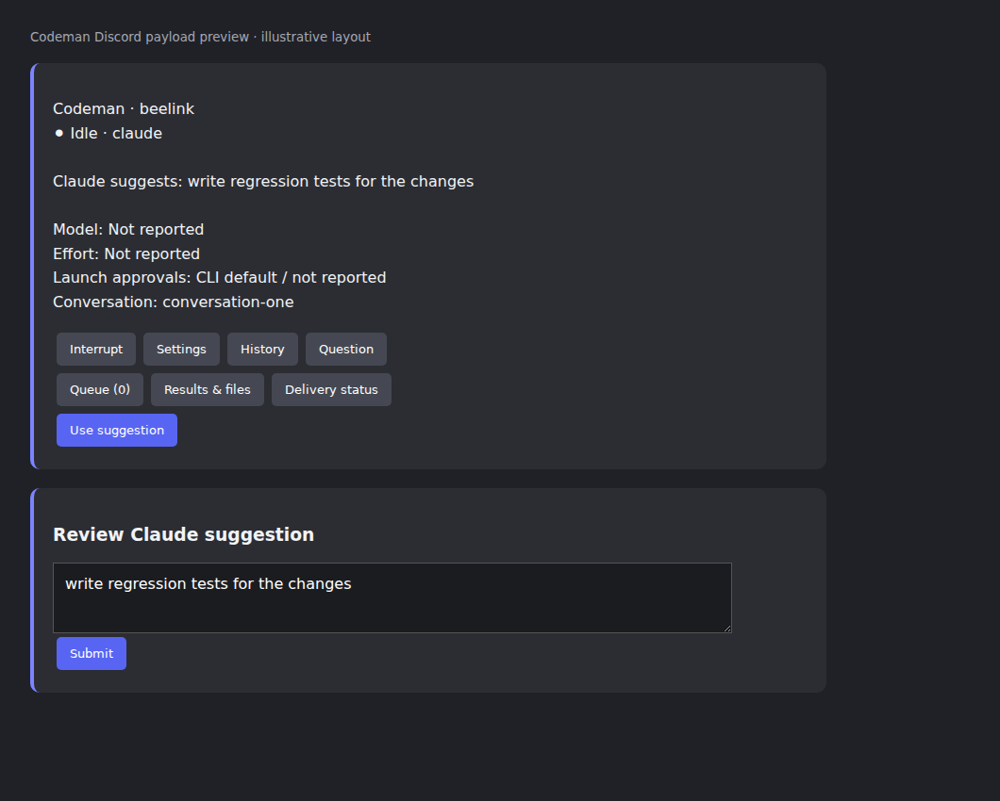

# Unified Working status and Claude suggestions

Foreground work, background tasks, and waiting/checking agents share the Working label and typing state. Needs input and Offline retain precedence; Idle still settles after 30 seconds. This avoids rename notices when work changes type.

The session card displays Claude's own faint composer suggestion when the session is ready. Use suggestion opens an editable modal. Submitting revalidates the suggestion, exact conversation, input revision, authorization and availability through the existing guarded follow-up path. Stale, duplicate and ambiguous submissions do not replay. Typed drafts are excluded. No additional model request is made.

The image is an illustrative browser rendering of a payload produced by the compiled production candidate, not a screenshot of Discord's client. Discord controls final layout. A measured Claude 2.1.300 styled composer fixture supplied the suggestion. The compiled check verified the card and prefilled modal, with zero automatic submissions. Unit/integration coverage includes local and SSH background activity across restart, parsed cursor styling, draft exclusion, edited prompts, stale suggestions, busy state, changed conversations/revisions, unauthorized users and duplicate interactions.
