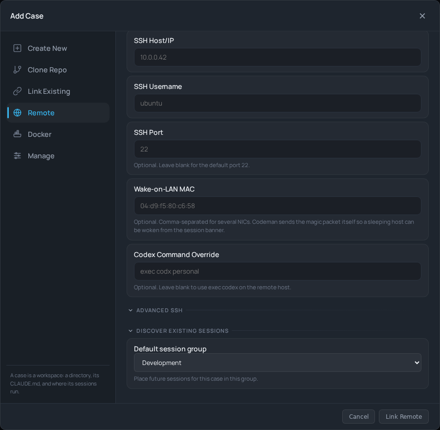
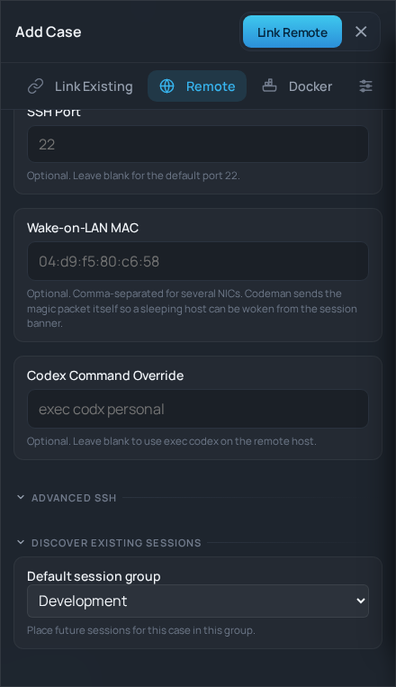

# New-case default session groups (#38)

The Add Case dialog now loads the owner's available groups for new cases, including Link Remote. The choice persists across creation tabs and is saved before automatically starting a session. Failed saves report that the case exists and prevent automatic startup in the wrong group.

Rendered desktop/mobile validation used the production markup and styles with the candidate session UI module. Session connections and writes were intercepted. These screenshots use sample group names. Browser regressions cover local/remote linking, stale responses, existing-case editing, and failed group saves.

